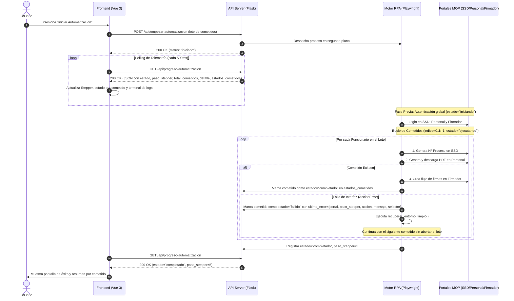
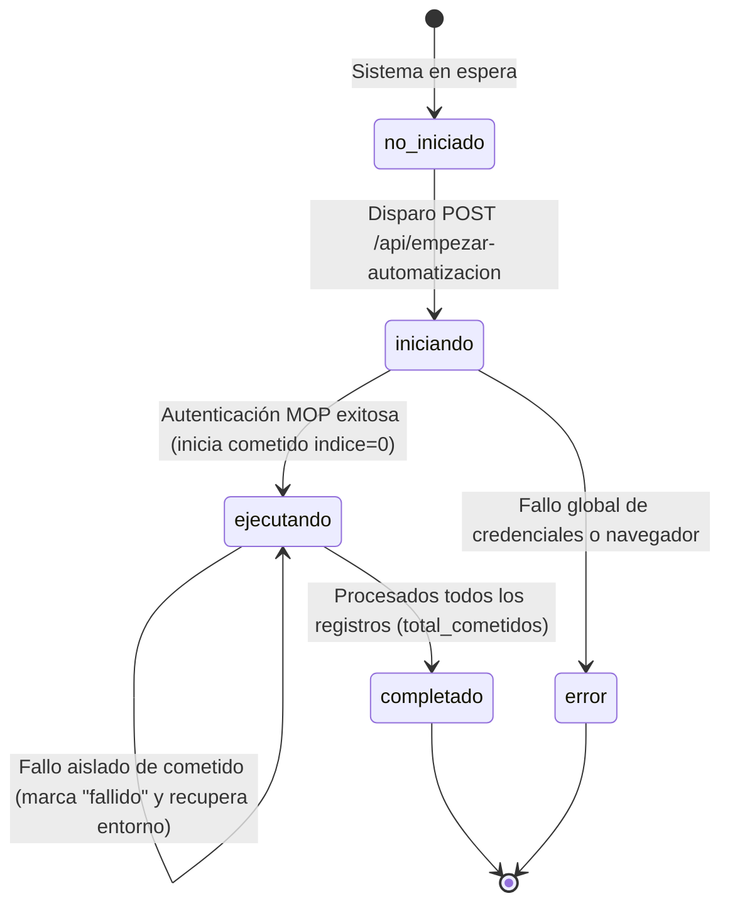

# Documento de Control de Interfaz (Interface Control Document - ICD)
## Subsistema de Automatización RPA ↔ Subsistema de Interfaz de Usuario (Vue 3)

---

### Control del Documento

| Atributo | Detalle |
| :--- | :--- |
| **Proyecto** | Automatización Robótica de Procesos (RPA) para Cometidos Funcionales MOP |
| **Documento** | Especificación Formal de Contrato de Interfaz de Software (ICD) |
| **Estándar de Referencia** | Adaptación de IEEE Std 1016-2009 (*Software Design Descriptions*) |
| **Subsistemas Involucrados**| Motor de Automatización Playwright (Backend) ↔ Consola Web Vue 3 (Frontend) |
| **Versión** | 1.0.0 |
| **Estado** | Aprobado para Integración |

---

## 1. Propósito y Alcance

### 1.1 Propósito
El propósito de este documento es definir formalmente el **Contrato de Interfaz de Datos (Data Contract)** entre el subsistema de ejecución y orquestación robótica (desarrollado en Python / Playwright) y el subsistema de visualización y control de usuario (desarrollado en Vue 3 / Vite). 

Este documento especifica los protocolos de comunicación, la semántica de la carga útil (payload), los diagramas de transición de estados y los mecanismos deterministas de aislamiento de fallos, sirviendo como:
1. **Acuerdo técnico vinculante** entre los desarrolladores de backend y frontend para desacoplar el desarrollo de ambos módulos.
2. **Evidencia formal de ingeniería de software** para el capítulo de *Diseño de Arquitectura e Interfaces* en la memoria de título / tesis de grado.

### 1.2 Alcance
El contrato abarca el ciclo de vida completo de la ejecución de cometidos:
* Fase de autenticación previa en portales MOP (SSD, Personal, Firmador).
* Bucle iterativo de procesamiento por cada funcionario.
* Transmisión de telemetría atómica (micro-pasos) hacia el Stepper y la consola visual.
* Captura estructurada de excepciones de interfaz de usuario mediante objetos tipados de error.
* Finalización y consolidación del lote.

---

## 2. Arquitectura de Integración y Protocolo de Comunicación

### 2.1 Protocolo de Transporte
* **Mecanismo:** HTTP REST / Polling asíncrono unidireccional (Near Real-Time Telemetry).
* **Endpoint de Telemetría:** `GET /api/progreso-automatizacion`
* **Formato de Intercambio:** JSON (MIME type: `application/json; charset=utf-8`).
* **Frecuencia de Muestreo Recomendada:** Intervalo de 400 ms a 600 ms.

### 2.2 Diagrama de Secuencia del Ciclo de Vida (UML)



---

## 3. Máquina de Estados del Proceso

El motor de automatización opera como una máquina de estados finitos determinista. El frontend debe sincronizar su interfaz reactiva basándose en la variable `estado` de la raíz y el arreglo `estados_cometidos`.



### 3.1 Matriz de Transición y Comportamiento del Frontend

| Estado Global (`estado`) | Contexto en Backend | Comportamiento Requerido en Frontend |
| :--- | :--- | :--- |
| `"no_iniciado"` | El servicio está en reposo. No existe ejecución activa. | Botón de ejecución habilitado. Stepper en Paso 1 (Carga de datos). |
| `"iniciando"` | Inicialización de Playwright y login en portales MOP. `estados_cometidos` está vacío (`[]`) y `detalle` informa el inicio de sesión actual. | Mostrar loader y alimentar consola con `detalle` (*"Iniciando sesión en Sistema SSD"*, etc.). Stepper según `paso_stepper` (1 o 2). |
| `"ejecutando"` | Procesamiento iterativo de cometidos. Cada cometido que entra en proceso se agrega a `estados_cometidos` partiendo en `indice: 0`. | Stepper sigue estrictamente a `paso_stepper`. El cometido en curso (`indice + 1` de `total_cometidos`) muestra su `accion_actual` y `detalle`. |
| `"completado"` | Se completaron las iteraciones de la totalidad de registros (`total_cometidos`). | Detener polling. Stepper en Paso 5 (Fin). Renderizar resumen de cometidos (`"completado"` vs `"fallido"`). |
| `"error"` | Excepción crítica global previa al bucle (ej: credenciales inválidas, caída del navegador). | Detener polling. Mostrar alerta modal de error fatal con `detalle`. |

---

## 4. Especificación Formal de la Carga Útil (`Payload Specification`)

El endpoint `GET /api/progreso-automatizacion` retorna una estructura de datos jerárquica sin arreglos de historial redundantes: los campos `accion_actual` y `detalle` se sobrescriben siempre con la última acción ejecutada.

### 4.1 Definición de Tipos (TypeScript Interfaces)

```typescript
export interface ProgresoAutomatizacion {
  /** Estado global del ciclo de vida del motor RPA */
  estado: "no_iniciado" | "iniciando" | "ejecutando" | "completado" | "error";

  /** Indicador numérico absoluto para el componente Stepper visual (1 a 5) */
  paso_stepper: 1 | 2 | 3 | 4 | 5;

  /** Cantidad total de cometidos a procesar en el lote */
  total_cometidos: number;

  /**
   * Detalle descriptivo de la última acción global en curso (incluye logins y fin de lote).
   * Se sobrescribe en cada paso para alimentar la consola en vivo.
   */
  detalle: string;

  /** Lista estructurada con el estado y progreso individual de cada cometido procesado */
  estados_cometidos: EstadoCometido[];
}

export interface EstadoCometido {
  /** Índice base-0 del cometido en el lote (0 a total_cometidos - 1) */
  indice: number;

  /** RUT del funcionario asociado al cometido */
  rut: string;

  /** Estado individual de este cometido */
  estado: "ejecutando" | "completado" | "fallido";

  /** Portal en el que se encuentra (o donde finalizó/falló) este cometido */
  portal: "ssd" | "personal" | "firmador";

  /**
   * Nombre conciso de la última acción ejecutada o intentada (sin valores concatenados).
   * Si el cometido falla, conserva el nombre limpio de la acción en que ocurrió el fallo.
   */
  accion_actual: string;

  /**
   * Detalle descriptivo de la última acción de este cometido (incluyendo el valor ingresado).
   * Si el cometido falla, contiene el resumen legible del fallo.
   */
  detalle: string;

  /** Metadatos estructurados del fallo si estado === "fallido"; null en caso contrario */
  ultimo_error: ErrorDetalle | null;
}

export interface ErrorDetalle {
  /** Portal donde se produjo la excepción */
  portal: "ssd" | "personal" | "firmador" | "general";

  /** Etapa visual del Stepper asociada al fallo (2, 3 o 4) */
  paso_stepper: number;

  /** Acción atómica que se intentaba realizar cuando ocurrió el fallo */
  accion: string;

  /** Mensaje técnico detallado de la causa del error */
  mensaje: string;

  /** Selector CSS o identificador Playwright del elemento involucrado */
  selector: string;
}
```

### 4.2 Diccionario de Campos de Telemetría

#### A. Objeto Raíz (`ProgresoAutomatizacion`)

| Campo | Tipo | Nulo | Descripción y Semántica |
| :--- | :--- | :---: | :--- |
| `estado` | `String` | No | Estado global de la automatización (`"no_iniciado"`, `"iniciando"`, `"ejecutando"`, `"completado"`, `"error"`). |
| `paso_stepper` | `Integer` | No | Número de paso visual (1 a 5). Controla directamente la barra Stepper del frontend. |
| `total_cometidos` | `Integer` | No | Total de cometidos del lote. Permite mostrar `"Cometido (indice + 1) de total_cometidos"`. |
| `detalle` | `String` | No | Último mensaje emitido por el robot (se sobrescribe en cada micro-paso). |
| `estados_cometidos` | `Array` | No | Arreglo de objetos `EstadoCometido` (parte vacío `[]` durante el login y agrega cada cometido desde `indice: 0`). |

#### B. Objeto por Cometido (`EstadoCometido` dentro de `estados_cometidos`)

| Campo | Tipo | Nulo | Descripción y Semántica |
| :--- | :--- | :---: | :--- |
| `indice` | `Integer` | No | Índice base 0 (`0 <= indice < total_cometidos`). Vincula el cometido con la fila de la tabla en Vue. |
| `rut` | `String` | No | RUT del funcionario (ej: `"13193029-1"`). |
| `estado` | `String` | No | Estado del cometido individual: `"ejecutando"`, `"completado"` o `"fallido"`. |
| `portal` | `String` | No | Portal actual o último portal alcanzado por este cometido (`"ssd"`, `"personal"`, `"firmador"`). |
| `accion_actual` | `String` | No | **Acción concisa sin parámetros.** Ej: `"Ingresando fecha de inicio"` o `"Buscando atribución"`. Si falla, mantiene la última acción que intentó hacer. |
| `detalle` | `String` | No | **Acción con datos concretos legibles.** Ej: `"Ingresando fecha de inicio: 05/10/2026"`. |
| `ultimo_error` | `Object` | Sí | `null` mientras no falle; objeto `ErrorDetalle` si `estado === "fallido"`. |

### 4.3 Ejemplos Canónicos por Estado (`Canonical Payload Examples`)

#### Caso 1: Fase de Autenticación Previa (`estado = "iniciando"`)
El motor está iniciando sesión en los portales institucionales antes de procesar el primer registro (`estados_cometidos` se mantiene vacío `[]`):

```json
{
    "estado": "iniciando",
    "paso_stepper": 2,
    "total_cometidos": 2,
    "detalle": "Ingresando usuario SSD: admin",
    "estados_cometidos": []
}
```

#### Caso 2: Procesamiento Iterativo en Curso (`estado = "ejecutando"`)
El primer cometido (`indice: 0`) falló en el portal Personal y fue aislado; el motor ya avanzó al segundo cometido (`indice: 1`) y se encuentra ejecutándolo en tiempo real:

```json
{
    "estado": "ejecutando",
    "paso_stepper": 3,
    "total_cometidos": 2,
    "detalle": "Ingresando fecha de inicio: 28/09/2026",
    "estados_cometidos": [
        {
            "indice": 0,
            "rut": "13193029-1",
            "estado": "fallido",
            "portal": "personal",
            "accion_actual": "Buscando atribución",
            "detalle": "Fallo en PERSONAL (Buscando atribución): No apareció la opción para seleccionar la atribución '2698'",
            "ultimo_error": {
                "portal": "personal",
                "paso_stepper": 3,
                "accion": "Buscando atribución",
                "mensaje": "No apareció la opción para seleccionar la atribución '2698'",
                "selector": "#btnSeleccionaConfiere"
            }
        },
        {
            "indice": 1,
            "rut": "13193029-1",
            "estado": "ejecutando",
            "portal": "personal",
            "accion_actual": "Ingresando fecha de inicio",
            "detalle": "Ingresando fecha de inicio: 28/09/2026",
            "ultimo_error": null
        }
    ]
}
```

#### Caso 3: Lote Finalizado (`estado = "completado"`)
El motor terminó de iterar sobre la totalidad de los registros (`total_cometidos`):

```json
{
    "estado": "completado",
    "paso_stepper": 5,
    "total_cometidos": 2,
    "detalle": "Todos los cometidos fueron procesados",
    "estados_cometidos": [
        {
            "indice": 0,
            "rut": "13193029-1",
            "estado": "fallido",
            "portal": "personal",
            "accion_actual": "Buscando atribución",
            "detalle": "Fallo en PERSONAL (Buscando atribución): No apareció la opción para seleccionar la atribución '2698'",
            "ultimo_error": {
                "portal": "personal",
                "paso_stepper": 3,
                "accion": "Buscando atribución",
                "mensaje": "No apareció la opción para seleccionar la atribución '2698'",
                "selector": "#btnSeleccionaConfiere"
            }
        },
        {
            "indice": 1,
            "rut": "13193029-1",
            "estado": "completado",
            "portal": "firmador",
            "accion_actual": "Flujo creado exitosamente",
            "detalle": "Flujo de firmas creado exitosamente en Firmador",
            "ultimo_error": null
        }
    ]
}
```

---

## 5. Mapeo Determinista del Stepper Visual

El componente visual de navegación (Stepper) **no debe realizar inferencias basadas en texto ni búsquedas por expresiones regulares**. La sincronización se rige estrictamente por `paso_stepper`:

```
┌──────────────┐     ┌──────────────┐     ┌──────────────┐     ┌──────────────┐     ┌──────────────┐
│    Paso 1    │ ──> │    Paso 2    │ ──> │    Paso 3    │ ──> │    Paso 4    │ ──> │    Paso 5    │
│ Validación   │     │ Sistema SSD  │     │   Personal   │     │   Firmador   │     │ Finalización │
│   (Excel)    │     │  (Carátula)  │     │  (Viáticos)  │     │   (Firmas)   │     │  (Reportes)  │
└──────────────┘     └──────────────┘     └──────────────┘     └──────────────┘     └──────────────┘
paso_stepper = 1     paso_stepper = 2     paso_stepper = 3     paso_stepper = 4     paso_stepper = 5
```

---

## 6. Protocolo de Resiliencia y Manejo Dinámico de Errores

### 6.1 Filosofía de Aislamiento de Fallos (`Fault Isolation`)
Una falla en un cometido individual (ej: funcionario sin contrato vigente, código de atribución no encontrado, caída puntual de un popup) **no detiene la ejecución del lote**.

1. El motor captura el error mediante la excepción tipada `AccionError`.
2. En `progreso_automatizacion.json`, el elemento correspondiente dentro de `estados_cometidos` pasa a `estado: "fallido"`, manteniendo en `accion_actual` el nombre limpio de la última acción intentada y guardando el diagnóstico en `ultimo_error`. Asimismo, en `datos_automatizacion.json` el registro queda con `estado_proceso: "fallido"`.
3. Se invoca el procedimiento de saneamiento `recuperar_entorno_limpio()`, el cual:
   * En **SSD**: cierra cualquier ventana emergente (popup) huérfana y vuelve a abrir el formulario en blanco de *"Despachar Documentos"* desde el menú superior (`frmMenu` → `frmMain`).
   * En **Personal** y **Firmador**: redirige las pestañas a sus URLs iniciales de creación (`FormCreaViatico` y `Creacion_Flujo`) para garantizar formularios limpios.
4. El orquestador avanza al siguiente `indice` y continúa procesando el siguiente funcionario.

### 6.2 Semántica de Cierre de Lote vs. Resultado por Ítem (`Job Status vs. Item Outcome`)
Cuando la propiedad raíz alcanza `estado === "completado"`, significa que **el motor finalizó la ejecución del lote completo**. El subsistema consumidor debe inspeccionar los elementos de `estados_cometidos` para clasificar el resultado operativo de la corrida en una de tres categorías:

| Clasificación de Cierre | Condición Lógica sobre `estados_cometidos` | Comportamiento Visual Esperado en Cliente |
| :--- | :--- | :--- |
| **Éxito Total (`Full Success`)** | Todos los elementos cumplen `c.estado === "completado"`. | Notificación de éxito general (verde). Todos los registros completados sin observaciones. |
| **Éxito Parcial (`Partial Success`)** | Al menos un elemento tiene `c.estado === "completado"` y al menos uno tiene `c.estado === "fallido"`. | Notificación de finalización con advertencias (ámbar/amarillo). Mostrar resumen de completados vs. fallidos con detalle de `ultimo_error`. |
| **Fallo Total de Lote (`Total Item Failure`)** | Todos los elementos cumplen `c.estado === "fallido"`. | Notificación de alerta (rojo) detallando el motivo de fallo de cada cometido en `estados_cometidos`. |

### 6.3 Construcción Dinámica de Mensajes de Error (Humanización)
El frontend puede usar los metadatos de `ultimo_error` dentro de cada elemento de `estados_cometidos` para construir notificaciones claras y explicativas para el operador humano, separando la causa funcional del detalle técnico:

```javascript
/**
 * Transforma la telemetría de error técnico en un mensaje comprensible de negocio.
 * @param {ErrorDetalle} err Objeto ultimo_error del cometido fallido
 * @param {string} rutFuncionario Identificador del funcionario (cometido.rut)
 * @returns {string} Mensaje formateado para el usuario
 */
export function construirMensajeErrorHumano(err, rutFuncionario) {
  if (!err) return "Error no especificado"

  const mapaSistemas = {
    ssd: "el Sistema de Gestión Documental (SSD)",
    personal: "el Portal de Personal MOP",
    firmador: "el Portal Firmador MOP"
  }

  const sistema = mapaSistemas[err.portal] || "el sistema institucional"
  const funcionario = rutFuncionario ? `para el funcionario ${rutFuncionario}` : ""

  return `No fue posible completar el registro ${funcionario} en ${sistema}. ` +
         `El proceso falló durante la acción "${err.accion}". ` +
         `(Detalle técnico: ${err.mensaje})`
}
```

---

## 7. Contrato de Datos de Resultados Finales (`datos_automatizacion.json`)

Al finalizar la ejecución, cada elemento del conjunto de datos persistido en disco cuenta con el reporte consolidado de su procesamiento:

```json
[
  {
    "rut": "13193029-1",
    "numero_ssd": "20573641",
    "ruta_pdf": "",
    "estado_proceso": "fallido",
    "error": {
      "portal": "personal",
      "paso_stepper": 3,
      "accion": "Buscando atribución",
      "mensaje": "No apareció la opción para seleccionar la atribución '2698'",
      "selector": "#btnSeleccionaConfiere"
    }
  },
  {
    "rut": "13193029-1",
    "numero_ssd": "20573642",
    "ruta_pdf": "/home/r0ars/Documents/RPAcometidos/temp_pdfs/cometido_13193029-1.pdf",
    "estado_proceso": "completado",
    "error": null
  }
]
```

Esto permite al frontend colorear las filas de la tabla de cometidos tanto en tiempo real (usando `estados_cometidos` en `progreso_automatizacion.json`) como en el reporte final:
* Verde con check (✓) si `estado === "completado"`.
* Rojo de alerta (✗) con acceso al diagnóstico de `ultimo_error` si `estado === "fallido"`.

---

## 8. Entorno Sandbox e Inyección Determinista de Fallos (`Test Harness`)

Para permitir el desarrollo, integración y pruebas de interfaz sin requerir conectividad a la intranet MOP ni credenciales reales, el backend provee un motor de simulación determinista configurable mediante variables de entorno en el archivo `.env`:

| Variable de Entorno (`.env`) | Valores | Comportamiento del Subsistema Backend |
| :--- | :---: | :--- |
| `MODO_SIMULACION` | `true` \| `false` | Si es `true`, `POST /api/empezar-automatizacion` invoca el simulador de telemetría (`simulador.py`) en lugar de abrir el navegador de Playwright, emitiendo exactamente la misma secuencia de eventos y estados para un mínimo de 2 cometidos. |
| `SIMULAR_FALLO` | `true` \| `false` | *(Aplica cuando `MODO_SIMULACION=true`)*<br>• `false`: **Escenario Camino Feliz (`Full Success`)**. Ambos cometidos (`indice: 0` e `indice: 1`) completan los portales SSD, Personal y Firmador con `estado: "completado"`.<br>• `true`: **Escenario de Inyección de Fallo (`Partial Success / Fault Isolation`)**. El primer cometido (`indice: 0`) falla en el portal Personal durante la acción `"Buscando atribución"` (`estado: "fallido"`), y el motor continúa procesando exitosamente el segundo cometido (`indice: 1`) hasta `"completado"`. |

---

## 9. Matriz de Deprecación y Migración de Esquema (`Legacy → v1.0.0`)

Con la formalización de la versión `1.0.0` de este contrato se eliminaron los campos planos por cometido en la raíz del JSON y el arreglo acumulativo `historial` del prototipo previo, consolidando el seguimiento individual dentro de la colección `estados_cometidos`:

| Campo Deprecado (`Legacy`) | Estado en `v1.0.0` | Equivalente en Contrato `v1.0.0` | Regla de Resolución para el Consumidor |
| :--- | :---: | :--- | :--- |
| `total` *(raíz)* | Renombrado | `total_cometidos` *(raíz)* | Leer directamente `data.total_cometidos`. |
| `indice` *(raíz)* | Movido | `estados_cometidos[i].indice` | Obtener el cometido activo (`estados_cometidos.find(c => c.estado === "ejecutando") ?? estados_cometidos.at(-1)`) y leer su propiedad `.indice` (base 0). |
| `paso` *(raíz)* | Eliminado | `estados_cometidos[i].indice + 1` | Para etiquetas humanas (*"Cometido X de Y"*), calcular `cometidoActivo.indice + 1`. |
| `nombre` *(raíz)* | Movido | `estados_cometidos[i].rut` | Leer el RUT del funcionario desde `cometidoActivo.rut`. |
| `portal` *(raíz)* | Movido | `estados_cometidos[i].portal` | Leer el portal activo del cometido desde `cometidoActivo.portal` (`"ssd"`, `"personal"`, `"firmador"`). |
| `accion_actual` *(raíz)* | Movido | `estados_cometidos[i].accion_actual` | Leer la acción concisa actual desde `cometidoActivo.accion_actual`. |
| `ultimo_error` *(raíz)* | Movido | `estados_cometidos[i].ultimo_error` | Cada cometido mantiene su propio `ultimo_error` aislado sin sobrescribir ni contaminar los demás cometidos del lote. |
| `historial` *(raíz)* | Eliminado | `detalle` *(raíz y por cometido)* | Eliminado por redundancia de almacenamiento. El consumidor debe alimentar su consola reactiva leyendo `data.detalle` en cada ciclo de polling cuando su valor cambie. |

---

## 10. Verificación y Cumplimiento

Cualquier cambio o extensión sobre este contrato de interfaz deberá ser sometido a:
1. Actualización de este documento ICD bajo control de versiones Git.
2. Validación cruzada de pruebas entre el módulo `rpacometidos.robots` y los componentes de `frontend/src/views`.

